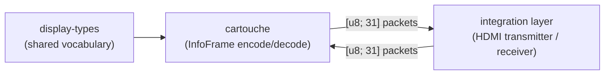
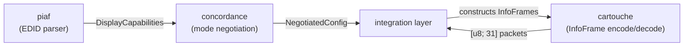

# cartouche

[](https://github.com/ashlar-display/cartouche/actions/workflows/ci.yml)
[](https://crates.io/crates/cartouche)
[](https://docs.rs/cartouche)
[](https://github.com/ashlar-display/cartouche/blob/main/LICENSE)
[](https://blog.rust-lang.org/2025/02/20/Rust-1.85.0.html)
[](https://slsa.dev)
[](#verifying-releases)

> **Part of [Ashlar](https://ashlar-display.org)** — a display connection stack in Rust,
> HDMI 2.1 first: from EDID parsing through mode negotiation to FRL link training.
>
> [display-types](https://github.com/DracoWhitefire/display-types) ·
> [piaf](https://github.com/DracoWhitefire/piaf) ·
> [concordance](https://github.com/DracoWhitefire/concordance) ·
> **cartouche** ·
> [culvert](https://github.com/DracoWhitefire/culvert) ·
> [plumbob](https://github.com/DracoWhitefire/plumbob) ·
> [hdmi-hal](https://github.com/DracoWhitefire/hdmi-hal) ·
> [hdmi-hal-i2c-dev](https://github.com/DracoWhitefire/hdmi-hal-i2c-dev)

Encoding and decoding for HDMI InfoFrames.

cartouche encodes and decodes HDMI 2.1 InfoFrames. All five HDMI 2.1 InfoFrame types are
fully supported: AVI, Audio, HDR Static Metadata, HDMI Forum Vendor-Specific, and Dynamic
HDR (HDR10+ and SL-HDR). It is a pure encoding/decoding library with no I/O and no
allocation requirement.

InfoFrames are the auxiliary metadata packets transmitted in the data island periods of an
HDMI signal. The AVI InfoFrame signals color space and colorimetry; the HDR InfoFrames
carry mastering metadata and dynamic tone mapping parameters; the HDMI Forum VSI signals
ALLM, VRR, and DSC state.

```rust
use cartouche::avi::{
    AviInfoFrame, BarInfo, Colorimetry, ExtendedColorimetry, ItContentType,
    NonUniformScaling, PictureAspectRatio, RgbQuantization, ScanInfo, YccQuantization,
};
use cartouche::encode::IntoPackets;
use display_types::ColorFormat;

// Encode
let frame = AviInfoFrame {
    color_format: ColorFormat::Rgb444,
    colorimetry: Colorimetry::NoData,
    extended_colorimetry: ExtendedColorimetry::XvYCC601,
    picture_aspect_ratio: PictureAspectRatio::SixteenByNine,
    active_format_present: false,
    active_format_aspect_ratio: 0,
    bar_info: BarInfo::NotPresent,
    scan_info: ScanInfo::NoData,
    it_content: false,
    it_content_type: ItContentType::Graphics,
    rgb_quantization: RgbQuantization::Default,
    ycc_quantization: YccQuantization::LimitedRange,
    non_uniform_scaling: NonUniformScaling::None,
    vic: 16,
    pixel_repetition: 0,
    top_bar: 0,
    bottom_bar: 0,
    left_bar: 0,
    right_bar: 0,
};
let encoded = frame.into_packets();
for warning in encoded.iter_warnings() {
    eprintln!("encode warning: {:?}", warning);
}
for packet in encoded.value {
    transmit(&packet);  // your integration layer
}

// Decode
let decoded = AviInfoFrame::decode(&packet)?;
let frame = decoded.value;
for warning in decoded.iter_warnings() {
    eprintln!("decode warning: {:?}", warning);
}
```

The top-level `decode` function dispatches on the type code and returns an `InfoFramePacket`:

```rust
use cartouche::decode;

match decode(&packet)?.value {
    InfoFramePacket::Avi(f)          => { /* f: AviInfoFrame */ }
    InfoFramePacket::Audio(f)        => { /* f: AudioInfoFrame */ }
    InfoFramePacket::HdrStatic(f)    => { /* f: HdrStaticInfoFrame */ }
    InfoFramePacket::HdmiForumVsi(f) => { /* f: HdmiForumVsi */ }
    InfoFramePacket::DynamicHdrFragment(frag) => { /* accumulate sequence */ }
    InfoFramePacket::Unknown { type_code, .. } => { /* unrecognised type */ }
}
```



## Why cartouche

**Complete coverage.** All five HDMI 2.1 InfoFrame type codes are fully encoded and
decoded: AVI, Audio, HDR Static, HDMI Forum VSI, and Dynamic HDR (HDR10+ and SL-HDR
metadata structs included).

**Typed fields, not raw bytes.** Color spaces are enums, not integers. VICs are 7-bit
wire values; out-of-range values produce an encode warning rather than being silently
truncated. Raw bytes appear only in `Unknown` variants, where they are preserved exactly
because the type is not understood.

**Warnings without data loss.** Anomalous values (bad checksum, reserved field,
out-of-spec value) produce a warning, not an error. On decode the warning is attached to
the returned frame; on encode it is attached to the returned `Decoded`. The caller
receives the data and the warning; nothing is silently discarded. Truncation is the
only hard error.

**Dynamic HDR is first-class.** The `IntoPackets` abstraction and the decode API are
designed for both single-packet and multi-packet (Dynamic HDR) frame types from the
start. For the four traditional types the transmission loop is already uniform:

```rust
let encoded = frame.into_packets();
// check encoded.iter_warnings()
for packet in encoded.value {
    transmit(&packet);
}
```

Dynamic HDR is fully supported: fragment decode, sequence assembly into typed
`Hdr10PlusMetadata` or `SlHdrMetadata` structs, and `IntoPackets` encoding are all
available and work without allocation.

**No allocation.** All encoding and decoding is done without a heap. The `Iter`
associated type on `IntoPackets` is a state machine that owns the frame — no `Vec`,
no lifetime parameters.

**No unsafe code.** `#![forbid(unsafe_code)]`.

## Features

| Feature | Default | Description                                                  |
|---------|---------|--------------------------------------------------------------|
| `std`   | yes     | Enables `std` support; implies `alloc`                       |
| `alloc` | no      | Enables `alloc` without `std`; `Decoded<T,W>` uses `Vec<W>` |
| `serde` | no      | Derives `Serialize`/`Deserialize` on all public types        |

Without `alloc` or `std`, `Decoded<T, W>` stores up to 8 warnings in a fixed
`[Option<W>; 8]` array. Access is always through `iter_warnings()`, which is portable
across all build configurations.

## `no_std` builds

cartouche declares `#![no_std]`. All encoding is done through iterators over
stack-allocated state; all decoding takes caller-provided slices. Neither encoding nor
decoding touches the heap.

The `alloc` feature (implied by `std`) has two effects. First, `Decoded<T, W>`'s warning
storage switches from a fixed `[Option<W>; 8]` array to a `Vec<W>`, removing the 8-warning
cap. Second, `DynamicHdrInfoFrame::Unknown` retains the raw payload bytes in its `payload`
field, making unrecognised formats re-encodable; in bare builds the payload is discarded.
All encode and decode behaviour — including full HDR10+ and SL-HDR parsing — is otherwise
identical across build tiers.

## Stack position

cartouche is the InfoFrame encoding layer. concordance produces the negotiated
configuration that cartouche encodes; the integration layer transmits and receives the
resulting packets.



## Verifying releases

Releases from v0.2.0 onwards are built on GitHub Actions and attested with
[SLSA Build Level 2](https://slsa.dev) provenance. To verify a release
`.crate` against its signed provenance, install the
[GitHub CLI](https://cli.github.com/) and run:

```sh
gh attestation verify cartouche-X.Y.Z.crate --repo ashlar-display/cartouche
```

Releases from before the repository moved to the `ashlar-display` organization (0.2.0 and
0.3.0) were attested under its previous owner, and verify against it:

```sh
gh attestation verify cartouche-X.Y.Z.crate --owner DracoWhitefire \
  --signer-repo DracoWhitefire/cartouche
```

The attested `.crate` is attached to each
[GitHub release](https://github.com/ashlar-display/cartouche/releases).

Releases after 0.2.0 are also uploaded through crates.io
[trusted publishing](https://rust-lang.github.io/rfcs/3691-trusted-publishing-cratesio.html): the publish
workflow obtains a short-lived token via OpenID Connect instead of using a stored
API token. crates.io can also reject uploads made with an API token for this crate;
the badge above shows whether that setting is on. Each version's publishing details,
including the workflow run and commit, are available from the crates.io API:

```sh
curl -A "your-tool (contact)" https://crates.io/api/v1/crates/cartouche/X.Y.Z
# see .version.trustpub_data
```

0.1.0 and 0.2.0 were uploaded with an API token (0.1.0 by hand, 0.2.0 from CI); 0.1.0
carries no provenance and has no GitHub release.

## Documentation

Extended documentation lives under [`doc/`](doc/).

- [`doc/architecture.md`](doc/architecture.md) — wire format, encode/decode abstraction, InfoFrame types, and design principles
- [`doc/setup.md`](doc/setup.md) — build, test, and fuzzing commands
- [`doc/testing.md`](doc/testing.md) — testing strategy and fuzz targets
- [`doc/roadmap.md`](doc/roadmap.md) — planned features and future work
